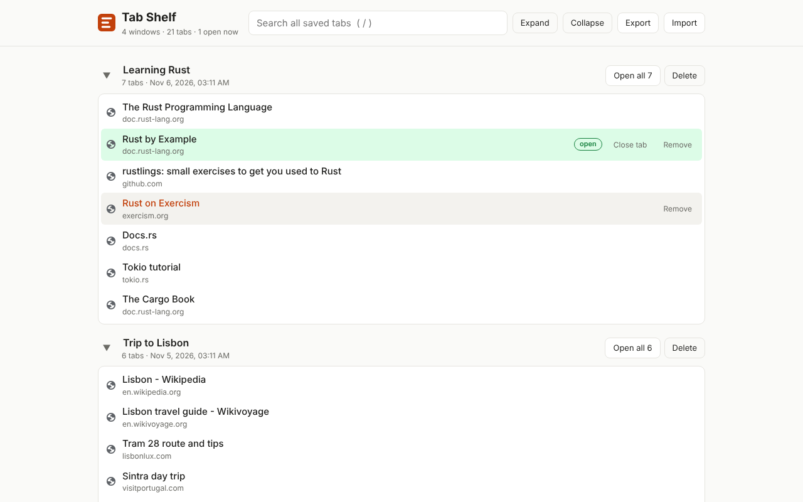

# Tab Shelf

Save windows full of tabs to a clean, searchable list, then open them **one at a time** when you need them. Clicking a link opens the tab; the link **stays on the shelf** for next time.

Built after losing several windows of tabs to tab managers that delete a saved window the moment you try to restore it. Tab Shelf never removes anything unless you ask it to, and every delete can be undone.



## Features

- **Save a whole window** from the toolbar button (or <kbd>Alt</kbd>+<kbd>Shift</kbd>+<kbd>S</kbd>): its tabs go onto the shelf and close, freeing memory.
- **Save-then-verify:** tabs are only closed after the save has been confirmed in storage.
- **Open one tab at a time:** click to open; it's marked *open*, and you can close it from the shelf. Closing the tab in Chrome returns you to the shelf.
- **Nothing disappears by accident:** opening tabs never removes them; deleting asks for confirmation and offers **Undo**.
- **Search** across every saved tab (press <kbd>/</kbd>), collapse/expand windows, rename windows (double-click the name).
- **Export / Import** a JSON backup. Import also reads Tabmate-style collection exports.
- **Private by design:** no accounts, no servers, no analytics. Everything stays in your browser.

## Install from source

1. Download this repository (green **Code** button → **Download ZIP**) and unzip it somewhere permanent.
2. Open `chrome://extensions` and turn on **Developer mode** (top right).
3. Click **Load unpacked** and select the `extension` folder.
4. Pin Tab Shelf from the puzzle-piece menu in the toolbar.
5. Optional: under Tab Shelf → **Details**, enable **Allow access to file URLs** so saved local files and PDFs can be reopened.

Works in Chrome and other Chromium browsers (Edge, Brave, Arc, Opera).

## Using it

| Action | How |
| --- | --- |
| Save this window and close its tabs | Toolbar button → **Save window & close its tabs** |
| Save without closing | Toolbar button → **Save window, keep tabs open** |
| Save just the current tab | Toolbar button → **Save this tab & close it** (goes to *Single tabs*) |
| Open a saved tab | Click it (Ctrl/Cmd-click or middle-click opens it in the background) |
| Rename a window | Double-click its name |
| Back up everything | **Export backup** on the shelf page |

## Permissions

| Permission | Why |
| --- | --- |
| `tabs` | Read the URLs and titles of the tabs you choose to save, open saved tabs, and close tabs after saving. |
| `storage`, `unlimitedStorage` | Keep your shelf in the browser's local extension storage, without a size cap. |
| `favicon` | Show each site's icon next to its link. |

Tab Shelf requests no website (host) permissions and makes no network requests.

## Project layout

```
extension/      the extension itself (load this folder, or zip it for the Chrome Web Store)
store/          Chrome Web Store screenshots, promo tile and listing text
PRIVACY.md      privacy policy
```

## License

[MIT](LICENSE)
